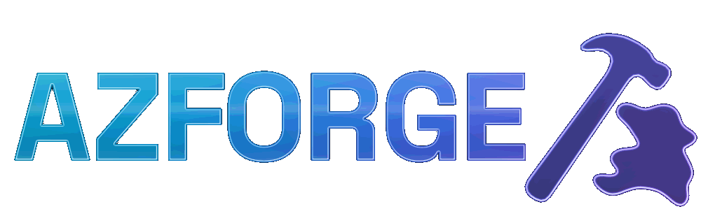

<p align="center">
  
</p>

# AzForge

A native modding platform for **Azangara**, a 2.5D platformer by AxySoft.

AzForge enters `game.exe` through a `d3d8.dll` proxy and exposes a versioned C/C++ API across
32 subsystems — from replacing assets and tweaking menus to custom 3D models, Direct3D 8
shaders, level editor extensions, and full frame-loop takeovers. Nothing is patched on disk:
removing `d3d8.dll` returns the game to stock.

**[Website & Installer](https://bazkamaz.github.io/AzForge/)** ·
**[Documentation](https://bazkamaz.github.io/AzForge/docs/index.html#/overview)** ·
**[API Reference](https://bazkamaz.github.io/AzForge/docs/index.html#/reference)**

## What it does

- **Non-destructive asset overrides** — replace scripts, levels, rooms, textures, models,
  sounds, or serve files from memory (`Files::Serve`). Resolution order: runtime overrides →
  mods → disk → `data.pak`.
- **Native Win32 mods** — `.amod` containers ship replacement files and an optional C/C++ DLL
  with zero scripting overhead, strict C ABI stability, and automatic teardown on unload.
- **Gameplay, UI, and world access** — control rooms, player, monsters, room mechanisms,
  bonuses, inventory, camera, particles, HUD, menus, console, input, audio, configs, and saves.
- **Custom rendering and 3D** — 2D menu-space drawing, custom textures and sprite fonts,
  batched `.mmd` and multi-part `.azm` models, `vs/ps 1.1` vertex/pixel shaders, plus full
  frame-loop and loading-screen control (`Stage`) and level editor hooks (`LevelEditor`).
- **In-game mod management and safety** — press **F10** (or run `mods screen`) for the built-in
  **MODS** overlay with hot-reload for regular code mods, signature-verified hooks that step
  aside on unknown builds, AMSI scanning, and crash reports in `forge.log`.

## Getting started

- **Playing with mods:** get the installer from the
  [AzForge website](https://bazkamaz.github.io/AzForge/), or copy `d3d8.dll` and `AzForge.dll`
  next to `game.exe` and drop `.amod` archives into `mods/`.
- **Making a mod:** follow the
  [Quick start](https://bazkamaz.github.io/AzForge/docs/index.html#/quickstart) guide, or create
  a ready-to-debug project with the Visual Studio (`plugins/vs2026/`) or VS Code
  (`plugins/vscode/`) extension — both build, pack, install, and launch `game.exe` under the
  debugger on **F5**.

## Documentation

Full guides and a searchable API reference (English and Russian) live on the documentation site:

- [Overview](https://bazkamaz.github.io/AzForge/docs/index.html#/overview) — architecture,
  resource resolution order, and mod composition
- [Quick start](https://bazkamaz.github.io/AzForge/docs/index.html#/quickstart) — building,
  packing, and running your first mod
- [Mod package & manifest](https://bazkamaz.github.io/AzForge/docs/index.html#/package) —
  `.amod` layout, `mod.json` fields, `amodpack` CLI, and load order
- [API model](https://bazkamaz.github.io/AzForge/docs/index.html#/apimodel) — C ABI contract,
  versioning, error codes, tokens, and lifetimes
- [API reference](https://bazkamaz.github.io/AzForge/docs/index.html#/reference) — all
  subsystems, functions, structs, callbacks, and constants

## Repository layout

| Path | What it is |
| --- | --- |
| `D3d8Proxy/` | `d3d8.dll` proxy that boots AzForge and hooks `Direct3DCreate8` |
| `src/` | Core loader (`AzForge.dll`), hooks, mod host, and subsystem implementations |
| `AmodPack/` | `AmodPack.exe` CLI for packing, validating, and installing `.amod` containers |
| `AzmPack/` | `AzmPack.exe` CLI converting OBJ + MTL (+ JSON sidecar) into `.azm` models |
| `sdk/` | Public C/C++ headers (`include/`), `subsystems.txt`, [`SampleMod/`](sdk/SampleMod/README.md), and `samples/car/` |
| `plugins/` | Shared mod template ([README](plugins/templates/README.md)), `AzForge.Mod.props`, Visual Studio VSIX (`vs2026/`), and [VS Code extension](plugins/vscode/README.md) |
| `AzForge-site/` | Project landing page and bilingual (EN / RU) documentation site |
| `installer/` | Custom standalone WPF installer (`AzForgeSetup.csproj`, `build.ps1`) |
| `tools/` | Standalone helpers (`room_grid.py` for inspecting `.room` grids) |

## Building from source

Open `AzForge.slnx` in Visual Studio or run MSBuild from a Developer Command Prompt:

```bat
msbuild AzForge.slnx /p:Configuration=Release /p:Platform=x86
```

All native targets are **Win32 (x86)** using C++20 and the static runtime (`/MT` / `/MTd`) —
`game.exe` is 32-bit, and players need no Visual C++ Redistributable. Building produces
`d3d8.dll`, `AzForge.dll`, `AmodPack.exe`, `AzmPack.exe`, and `SampleMod.amod`.

IDE extensions are built separately in `plugins/vs2026/Extension/` (Visual Studio 2022–2026
VSIX) and [`plugins/vscode/`](plugins/vscode/README.md).
