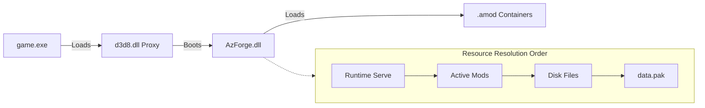

<div align="center">
  

  <p><strong>A native C/C++ modding framework &amp; SDK for Azangara, a 2.5D platformer by AxySoft</strong></p>

  <p>
    
    
    
    
  </p>

  <p>
    <a href="https://bazkamaz.github.io/AzForge/"><strong>🌐 Website &amp; Installer</strong></a> •
    <a href="https://bazkamaz.github.io/AzForge/docs/index.html#/overview"><strong>Documentation</strong></a> •
    <a href="https://bazkamaz.github.io/AzForge/docs/index.html#/reference"><strong>API Reference</strong></a>
  </p>
</div>

<br />

AzForge is a native C/C++ modding framework and runtime for **Azangara**, providing a versioned C ABI across 32 subsystems to build, package, and run mods without modifying original game files. Loaded transparently via a `d3d8.dll` proxy — while removing `d3d8.dll` cleanly restores the stock game.

<!-- Когда будет готово демо.
<div align="center">
  
  <p><em>Built-in MODS overlay (<kbd>F10</kbd>) with hot-reload and custom mod content in action.</em></p>
</div>
-->

---

## What it does

<table>
  <tr>
    <td width="50%" valign="top">
      <h3>Non-destructive Asset Overrides</h3>
      Replace scripts, levels, rooms, textures, models, and sounds, or serve files directly from memory (<code>Files::Serve</code>). Removing <code>d3d8.dll</code> restores the stock game.
    </td>
    <td width="50%" valign="top">
      <h3>Native Win32 Mods</h3>
      <code>.amod</code> containers ship replacement files and an optional C/C++ DLL with zero scripting overhead, strict C ABI stability, and automatic teardown on unload.
    </td>
  </tr>
  <tr>
    <td width="50%" valign="top">
      <h3>Rendering, Models &amp; Shaders</h3>
      2D menu-space drawing, custom textures and sprite fonts, batched <code>.mmd</code> and multi-part <code>.azm</code> models, <code>vs/ps 1.1</code> vertex/pixel shaders, plus full frame-loop/loading-screen control (<code>Stage</code>) and level editor hooks (<code>LevelEditor</code>).
    </td>
    <td width="50%" valign="top">
      <h3>In-Game Management &amp; Safety</h3>
      Press <kbd>F10</kbd> (or run <code>mods screen</code>) for the built-in <strong>MODS</strong> overlay with hot-reload for regular code mods, signature-verified hooks that step aside on unknown builds, AMSI scanning, and crash reports in <code>forge.log</code>.
    </td>
  </tr>
  <tr>
    <td colspan="2" valign="top">
      <h3>Gameplay, UI &amp; World Access</h3>
      Full native access to rooms, player, monsters, room mechanisms, bonuses, inventory, camera, particles, HUD, menus, console, input, audio, configs, and saves.
    </td>
  </tr>
</table>

---

## Architecture & Resource Resolution



---

## Getting started

- **Playing with mods:** get the installer from the [AzForge website](https://bazkamaz.github.io/AzForge/), or copy `d3d8.dll` and `AzForge.dll` next to `game.exe` and drop `.amod` archives into `mods/`.
- **Making a mod:** follow the [Quick start](https://bazkamaz.github.io/AzForge/docs/index.html#/quickstart) guide, or create a ready-to-debug project with the Visual Studio (`plugins/vs2026/`) or VS Code (`plugins/vscode/`) extension — both build, pack, install, and launch `game.exe` under the debugger on <kbd>F5</kbd>.

---

## Documentation

Full guides and a searchable API reference (English and Russian) live on the documentation site:

- [Overview](https://bazkamaz.github.io/AzForge/docs/index.html#/overview) — architecture, resource resolution order, and mod composition
- [Quick start](https://bazkamaz.github.io/AzForge/docs/index.html#/quickstart) — building, packing, and running your first mod
- [Mod package & manifest](https://bazkamaz.github.io/AzForge/docs/index.html#/package) — `.amod` layout, `mod.json` fields, `amodpack` CLI, and load order
- [API model](https://bazkamaz.github.io/AzForge/docs/index.html#/apimodel) — C ABI contract, versioning, error codes, tokens, and lifetimes
- [API reference](https://bazkamaz.github.io/AzForge/docs/index.html#/reference) — all subsystems, functions, structs, callbacks, and constants

---

## Building from source

> [!IMPORTANT]
> All native targets must be built for **Win32 (x86)** using **C++20** and the static runtime (`/MT` / `/MTd`). `game.exe` is 32-bit, and static linking ensures players don't need Visual C++ Redistributable.

Open `AzForge.slnx` in Visual Studio or run MSBuild from a Developer Command Prompt:

```bat
msbuild AzForge.slnx /p:Configuration=Release /p:Platform=x86
```

Building produces `d3d8.dll`, `AzForge.dll`, `AmodPack.exe`, `AzmPack.exe`, and `SampleMod.amod`.

<details>
<summary><strong>Building IDE Extensions (Visual Studio &amp; VS Code)</strong></summary>
<br />

IDE extensions are built separately from the main solution:

- **Visual Studio 2022–2026 (VSIX):** `plugins/vs2026/Extension/`
- **VS Code Extension:** [`plugins/vscode/`](plugins/vscode/README.md)

</details>

<details>
<summary><strong>Repository layout</strong></summary>
<br />

| Path | What it is |
| --- | --- |
| `D3d8Proxy/` | `d3d8.dll` proxy that boots AzForge and hooks `Direct3DCreate8` |
| `src/` | Core loader (`AzForge.dll`), hooks, mod host, and subsystem implementations |
| `AmodPack/` | `AmodPack.exe` CLI for packing, validating, and installing `.amod` containers |
| `AzmPack/` | `AzmPack.exe` CLI converting OBJ + MTL (+ JSON sidecar) into `.azm` models |
| `sdk/` | Public C/C++ headers (`include/`), `subsystems.txt`, [`SampleMod/`](sdk/SampleMod/README.md), and `samples/car/` |
| `plugins/` | Shared mod template ([README](plugins/templates/README.md)), `AzForge.Mod.props`, Visual Studio VSIX (`vs2026/`), and [VS Code extension](plugins/vscode/README.md) |
| `AzForge-site/` | Project landing page and bilingual (EN / RU) documentation site |
| `installer/` | Custom standalone WPF installer (`AzForgeSetup.csproj`, `build.ps1`) |
| `AFModConstructor/` | Visual Qt 6 event-sheet mod constructor |
| `tools/` | Standalone helpers (`room_grid.py` for inspecting `.room` grids) |

</details>